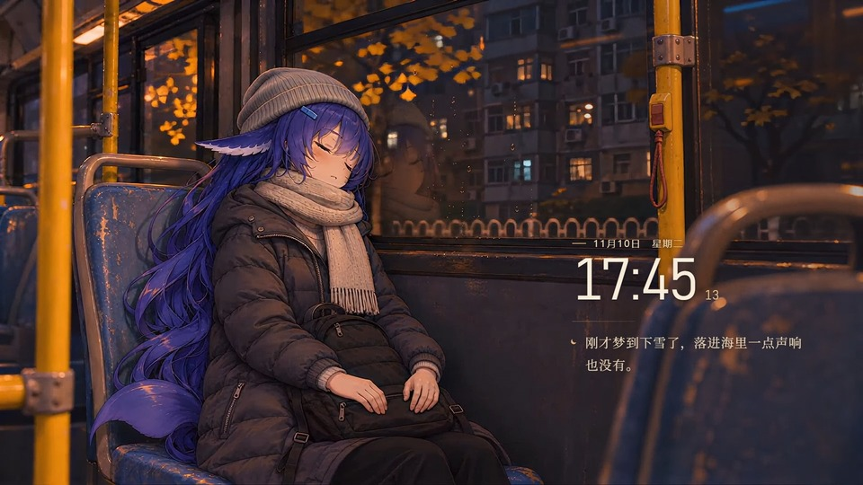

# DeepSeek Feiyu: Asleep on the Way Home

大肥鱼下班了。公交穿过北京的夜色，她把尾巴收在座位旁，靠着车窗睡着了。

A silent Wallpaper Engine wallpaper for Windows. Feiyu dozes by the window on her bus ride home. The right side shows your local time. While music plays, it displays the track, artist, and a waveform driven by your system audio. When playback pauses, one of 24 short thoughts in Chinese occasionally fades in.

The bus scene loops with a crossfade. The layout adapts to portrait, standard, and ultrawide screens. The wallpaper runs locally and contains no music or subtitle track.

## Run it

[Subscribe on Steam Workshop](https://steamcommunity.com/sharedfiles/filedetails/?id=3837239996) and select the wallpaper in Wallpaper Engine. To use the source, download or clone this repository into a subfolder of `wallpaper_engine/projects/myprojects/` and select it in Wallpaper Engine. You can also open `index.html` in a browser to preview the bus, clock, and idle thoughts.

For track titles, enable media integration in Wallpaper Engine and play music in a player that shares its metadata with Windows. The waveform uses Wallpaper Engine’s audio recording setting.

This is an unofficial fan work. The character scene was made with AI assistance. The web wallpaper was developed with OpenAI Codex.
